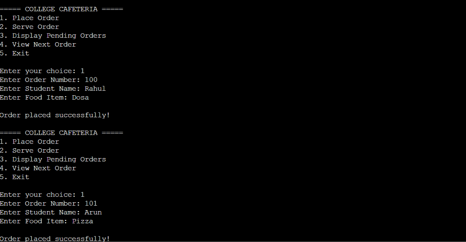
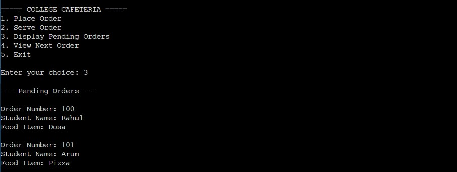
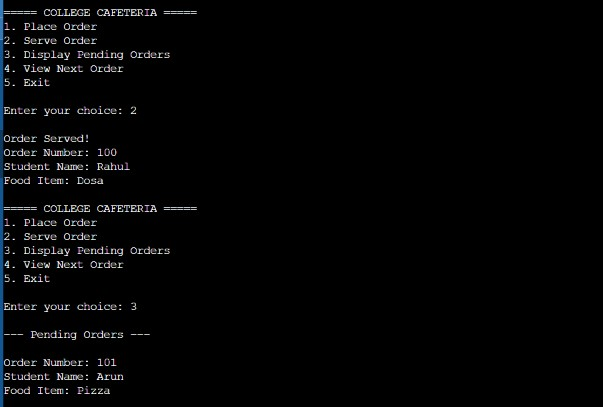

# College Cafeteria Order Management System

## 1. Introduction

The College Cafeteria Order Management System is a menu-driven application developed using the C programming language. It uses the Circular Queue data structure to manage food orders placed by students in a college cafeteria.

The system follows the FIFO (First In, First Out) principle, where the first order placed is the first order served.

## 2. Problem Statement

Managing multiple food orders in a college cafeteria manually can be difficult and time-consuming. This project provides a simple computerized system to add, serve, and display food orders efficiently using a Circular Queue.

## 3. Objectives

- To implement a Queue data structure using C.
- To manage cafeteria food orders efficiently.
- To follow the FIFO principle.
- To perform insertion and deletion operations.
- To reuse empty array positions using Circular Queue.

## 4. Data Structure Used

**Circular Queue**

A Circular Queue is a linear data structure in which the last position is connected to the first position.

It allows the reuse of empty spaces created after deleting elements.

### FIFO Principle

First In, First Out (FIFO) means the order inserted first will be served first.

## 5. Features

1. Place a new food order.
2. Serve the next pending order.
3. Display all pending orders.
4. View the next order without removing it.
5. Check whether the queue is full.
6. Check whether the queue is empty.
7. Reuse available positions through circular movement.

## 6. Queue Operations

| Operation | Description |
|---|---|
| Enqueue | Adds a new food order |
| Dequeue | Serves and removes the first order |
| Display | Shows all pending orders |
| Peek | Displays the next order |

## 7. Technologies Used

- Programming Language: C
- Data Structure: Circular Queue
- Compiler: OnlineGDB
- Version Control: GitHub

## 8. Queue Conditions

- Empty condition: front == -1
- Full condition: (rear + 1) % SIZE == front
- Circular movement: (position + 1) % SIZE

## 9. How to Run

1. Download or clone this repository.
2. Open cafeteria.c in a C compiler.
3. Compile and execute the program.
4. Select an operation from the menu.
5. Enter the required order details.

## 10. Conclusion

The College Cafeteria Order Management System demonstrates the practical implementation of a Circular Queue using C. It helps manage food orders based on the FIFO principle and allows efficient reuse of array positions.

## Screenshots

### 1. Placing Orders

### 2. Displaying Pending Orders

### 3. Serving an Order

### 4. Circular Queue Demonstration

